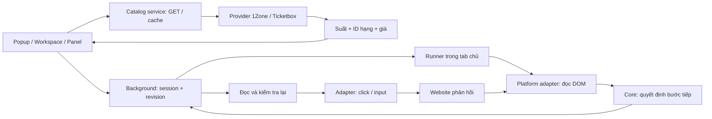
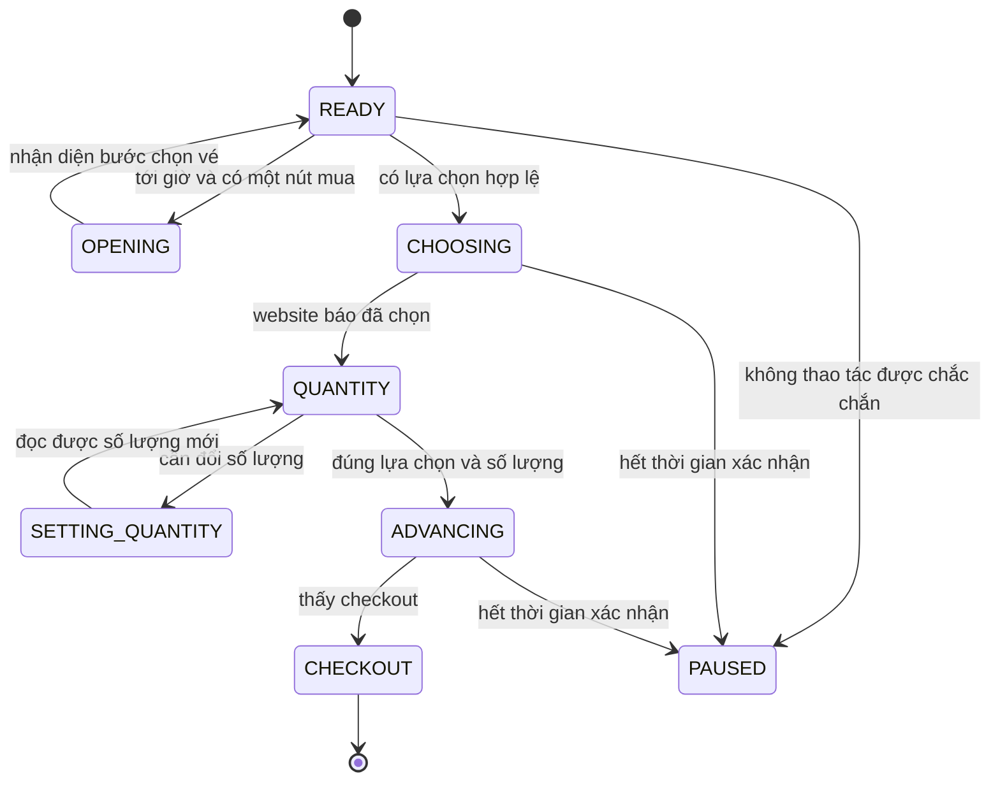

# Cơ chế camp vé · bản 0.3.0

Bản hiện tại kết nối **tìm sự kiện → chọn đúng suất/hạng/giá → camp tới checkout**. Bản 0.2.0 có bộ thực thi tự chọn vé; 0.3.0 bổ sung catalog API, cấu hình theo ID/giá và kiểm tra trước khi chạy. Tài liệu phân biệt kiểm thử cục bộ, GET công khai đã chạy thật và booking chưa xác minh trên sự kiện mục tiêu.

## 1. Đầu vào và đầu ra

Đầu vào gồm nền tảng, link concert/suất, giờ mở bán, số vé, ngân sách tổng và thứ tự zone/hạng vé. Mặc định **1 vé**, ngân sách trống. Cấu hình cũ được giữ đúng lựa chọn đã lưu.

Khi bấm **Bắt đầu camp**, tool dùng cấu hình đã lưu; nếu chọn qua catalog thì tải mới và đối chiếu dữ liệu trước. Sau đó vào bước mua, chọn lựa chọn phù hợp, cập nhật số lượng rồi bấm tiếp. Đầu ra thành công của bộ thực thi là **nhận diện trang checkout**. Đây chưa phải xác nhận server đã giữ vé hoặc thanh toán thành công.

Đăng nhập trước, hoàn thành xác minh khi website yêu cầu và thanh toán cuối vẫn là những bước người dùng thực hiện. Nhắc giờ là tính năng phụ.

## 2. Kiến trúc



| Lớp | Trách nhiệm | Phụ thuộc |
|---|---|---|
| Core | Model, URL policy, validate, xếp hạng, quyết định | TypeScript thuần |
| Application | Chạy từng bước, hẹn giờ, chống lệnh cũ, kiểm tra lại trước thao tác | Core, contract, transport được truyền vào |
| Platform | Provider chuyển schema API; adapter hiểu DOM/điều khiển riêng | Core; transport được truyền vào hoặc Browser DOM |
| Infrastructure | GET/cache, Chrome storage/session, messages, tab và alarm | Core, Chrome/fetch APIs |
| UI / entrypoints | Form, trạng thái, observer, lắp các thành phần | Các lớp trên |

Core không import React, Chrome hoặc DOM. Runner không import adapter 1Zone. Website khác dùng lại core và runner qua [contract](../src/platforms/contracts.ts) và [registry](../src/platforms/registry.ts).

## 3. Các kiểu dữ liệu

[models.ts](../src/core/models.ts) chứa `EventPreferences`, `PageSnapshot`, `VisibleOption` và cấu hình. `platform` là kiểu nền tảng chung. Mỗi lựa chọn ghi `ZONE/SEAT`, nhãn, nhãn khu nếu có, giá, tình trạng khả dụng và dấu đã chọn.

[automation.ts](../src/core/automation.ts) định nghĩa:

| Kiểu | Ý nghĩa |
|---|---|
| AutoRun | ID phiên, tab chủ, revision, fingerprint cấu hình, thời gian bắt đầu/hết hạn, progress |
| AutoProgress | Bước hiện tại, lựa chọn đã nhắm tới, mốc hành động, số lượng cần xác nhận |
| AutoPage | Snapshot chuẩn hóa, số nút vào mua/đi tiếp, các lựa chọn có thể bấm, số lượng đọc được, lỗi |
| AutoDecision | Chờ với mốc đánh thức, hoặc chuyển bước với một hành động |
| AutoAction | ENTER, CHOOSE, QUANTITY, ADVANCE |

ID option chỉ tồn tại trong một lần đọc. Qua các lần đọc, lựa chọn được đối chiếu bằng loại, nhãn, khu, giá và ID hạng nếu DOM cung cấp. Nếu hai lựa chọn trùng các dấu hiệu này, core dừng thay vì suy đoán vị trí.

### Catalog và cấu hình theo dữ liệu nguồn

[catalog.ts](../src/core/catalog.ts) định nghĩa các kiểu chung:

| Kiểu | Nội dung |
|---|---|
| ConcertSummary / ConcertDetail | Event ID, tên/link/địa điểm, các suất và currency |
| Performance | ID suất, địa điểm, giờ diễn, giới hạn số lượng nếu có |
| TicketType / TicketCatalog | ID hạng, tên, giá, giới hạn, mode ghế, thời điểm đọc và suất sở hữu |
| CatalogSelection | Event/suất và danh sách ID hạng + tên + giá đã chọn theo thứ tự |
| CatalogProvider | Contract search/detail/tickets, không có thao tác đặt vé |

`onezone-catalog.ts` đọc search API, JSON eventData trong HTML và summary hạng vé. `ticketbox-catalog.ts` đọc search và event/showings/ticketTypes. Mỗi provider kiểm tra schema, danh tính và giá trước khi trả model chung. Hai parser không gọi nhau.

`catalog-service.ts` sở hữu GET allowlist, timeout, cache và gộp request. Những GET tra cứu không đi vào hàng đợi tuần tự của automation. UI không nhận dữ liệu JSON thô hay token. `EventFinder` bỏ response đến muộn bằng phiên bản request; nhiều suất phải chọn rõ, link có ID suất sai không tự chuyển sang suất khác. Giờ diễn luôn ghi riêng, người dùng nhập giờ bán theo thông báo chính thức.

`TicketPriorities` dùng native select, cho thêm/đổi thứ tự/bỏ hạng. Lưu cấu hình giữ ID và giá; reopen vẫn giữ snapshot đã chọn. Form sửa chưa lưu hoặc cấu hình đổi ở cửa sổ khác sẽ khóa Bắt đầu camp cho tới khi lưu/tải lại.

Khi bật camp có catalog, detail và tickets được GET mới song song (`no-store`, không dùng cache). [catalog-validation.ts](../src/core/catalog-validation.ts) đối chiếu event/suất, ngày/địa điểm, VND, thời gian kết thúc, giới hạn số lượng, ID/tên/giá. Sai lệch thì không tạo phiên camp. Cấu hình cũ nhập thủ công vẫn dùng được, nhưng không có đối chiếu catalog này.

Khi chọn trên DOM, hạng ưu tiên phải khớp ID nếu có; thiếu ID thì khớp tên đã chuẩn hóa. Giá DOM phải khớp giá snapshot của hạng ưu tiên. Tình trạng trong catalog không thay thế phản hồi giữ vé của website. Chi tiết endpoint, cache và bằng chứng khảo sát nằm trong [nghiên cứu API](NGHIEN_CUU_API.md).

## 4. Máy trạng thái



Hàm `decideAutomation()` là hàm thuần: nhận phiên, trang chuẩn hóa, sở thích và thời gian; trả quyết định. Hàm không click và không ghi storage.

Quy tắc ưu tiên:

1. Dừng nếu cấu hình đổi hoặc phiên hết hạn.
2. Nhận diện checkout thì kết thúc, không bấm nút cuối.
3. Đăng nhập, CAPTCHA, thông báo giữ chỗ thất bại/hết hạn rõ ràng thì PAUSED.
4. Phòng chờ thì WAIT; không refresh, không gửi yêu cầu lấy chỗ khác.
5. Kiểm tra đúng concert/suất, giờ bán và giới hạn số vé.
6. READY chọn ưu tiên phù hợp. Hết vé hiển thị thì xét lựa chọn tiếp theo theo cấu hình.
7. Sau click, phải thấy dấu đã chọn; sau đổi số lượng, phải đọc được giá trị mục tiêu.
8. Chỉ ADVANCE khi đúng lựa chọn, đủ số lượng và có đúng một nút đi tiếp khả dụng.

Thời gian chờ xác nhận lựa chọn/số lượng khoảng 5 giây; điều hướng khoảng 15 giây. Quá thời gian sẽ dừng, không tự lặp click. Lúc khởi tạo cho phép tối đa 15 giây để giao diện chưa nhận diện được hoàn tất render; canvas/iframe không đọc được không được coi là đang tải.

## 5. Vì sao ghi trạng thái trước khi click?

[automation-service.ts](../src/infrastructure/automation-service.ts) chạy trong hàng đợi tuần tự của background. Content gửi ID phiên, revision hiện tại và progress tiếp theo.

Ví dụ:

```text
Tab: READY, revision=0
→ ghi CHOOSING với revision kỳ vọng 0
Background: chấp nhận, lưu revision=1
→ tab đọc lại DOM rồi click chọn
→ website phản hồi selected=true
→ ghi QUANTITY với revision kỳ vọng 1
```

Cùng lệnh revision=0 được gửi lại sẽ bị từ chối. Nếu tab điều hướng hoặc worker khởi động lại sau bước ghi, trạng thái vẫn là CHOOSING; tool chờ kết quả hoặc báo chưa xác nhận, không quay lại bấm chọn lần nữa.

Cơ chế này ưu tiên tránh lặp hành động. Nó **không tạo giao dịch nguyên tử giữa storage và server 1Zone**: nếu tab đóng sau khi ghi nhưng trước khi click, bước có thể chưa xảy ra. Kiểm tra trực tiếp rồi bắt đầu lại.

Sau bước ghi bất đồng bộ, [runner](../src/application/automation-runner.ts) đọc lại DOM và chạy lại quyết định từ trạng thái trước đó. Nếu nút, lựa chọn, URL hoặc giá đổi thì hủy hành động và PAUSED. Dừng phiên hoặc đổi cấu hình trong lúc chờ cũng làm lệnh cũ mất hiệu lực.

## 6. Một tab và vòng đời Chrome

Background lưu cấu hình trong `chrome.storage.local`; phiên camp trong `chrome.storage.session`. Dữ liệu session mặc định chỉ cho ngữ cảnh extension tin cậy; content nhận phiên của chính tab mình qua messages.

- Một phiên có một tab chủ; tab khác chỉ theo dõi.
- Đóng tab chủ hủy phiên. Reload/điều hướng tab trong cùng Chrome có thể tiếp tục trạng thái đã lưu.
- Worker dừng/chạy lại không làm mất session.
- Đóng/mở Chrome, reload/cập nhật/disable extension làm mất session; phải bắt đầu camp lại.
- Lưu lại cấu hình hoặc dừng theo dõi hủy phiên.
- Ẩn panel vẫn chạy camp; popup còn nút dừng.
- Phiên hết hạn sau 60 phút kể từ thời điểm muộn hơn giữa giờ bán và lúc bắt đầu.

Không có quy trình tự mở nhiều tab/tài khoản hoặc phối hợp giành chỗ.

## 7. Adapter 1Zone đọc và thao tác thế nào?

Các module [onezone.ts](../src/platforms/onezone.ts), [DOM](../src/platforms/onezone-dom.ts), [options](../src/platforms/onezone-options.ts), [selection](../src/platforms/onezone-selection.ts), [automation](../src/platforms/onezone-automation.ts) tách riêng nhận diện và thực thi.

Bộ đọc bỏ chữ ẩn, scripts, template và UI extension. Cache visibility/text chỉ sống trong một lần đọc. Snapshot và bindings trả cùng lượt để khớp đúng phần tử.

Lựa chọn phải có nhãn và đúng một giá rõ ràng. Thẻ giới thiệu chỉ có nút xem thông tin không được coi là vé mua được. Các ghế cùng giá trong một container vẫn là từng ghế; không gộp thành zone. Dấu selected đọc từ ARIA/radio, gồm `aria-pressed`.

Bộ thao tác chỉ bind điều khiển có ngữ nghĩa rõ ràng:

| Thao tác | Cách thực hiện |
|---|---|
| ENTER | Một nút/link mua vé khả dụng; link booking phải đúng concert/calendarId |
| CHOOSE | Nút/role chọn trực tiếp hoặc một điều khiển chọn duy nhất trong card |
| QUANTITY | Native setter + input/change cho input/select; bấm từng bước cho ARIA stepper có nút tăng/giảm |
| ADVANCE | Một điều khiển tiếp tục đã biết; loại nút trong thẻ vé, nút thanh toán/xác nhận cuối |

Giá/ngân sách, selected và số lượng được kiểm tra lại trước đi tiếp. Thay đổi thuộc tính DOM được quan sát; input/change cũng được lắng nghe vì gán property không nhất thiết tạo mutation.

Synthetic click/input là cơ chế DOM; một số ứng dụng không nhận loại sự kiện này hoặc không công khai trạng thái cần đọc. Khi đó cần bổ sung adapter từ DOM thật, không tuyên bố tương thích bằng fixture.

## 8. Zone, tự cấp ghế và chọn ghế

- ZONE_ONLY / ASSIGNED_SEAT: tự chọn khu rồi đặt số vé. Tự cấp ghế không mặc định là random hay liền nhau.
- PICK_SEAT: hiện tự chọn một ghế có nhãn/giá đọc được cho yêu cầu 1 vé.
- Nhiều vé với ghế riêng: chưa ghép nhóm, chưa tối ưu liền nhau.
- MIXED hoặc cần chọn ghế sau zone: dừng nếu chưa xác định được luồng khu tương ứng.
- Canvas/iframe thiếu dữ liệu: chưa có bộ thao tác tọa độ/map.

Nếu website không thể hiện selected hoặc số lượng đủ rõ, tool không đi tiếp chỉ vì nút đã được bấm.

## 9. Tốc độ được tối ưu ở đâu?

Ở chế độ theo dõi, nhiều mutation được gom theo khoảng 600 ms. Khi có phiên camp hoạt động, controller dùng khoảng gom **16 ms** để phản ứng với thay đổi trang. Runner xử lý tuần tự và phản ứng sau mỗi bước, không đợi countdown UI một giây.

Không có vòng polling mạng hoặc tự refresh. Các mốc giờ bán, timeout và hết phiên được đánh thức bằng timer; DOM/event đánh thức ngay khi cần đọc lại.

Chi phí mỗi hành động gồm đọc DOM, quyết định, ghi session qua background, kiểm tra lại và click, sau đó chờ website phản hồi. Tiết kiệm thời gian ở phần người dùng tìm/chọn/bấm; không làm server mở bán sớm hơn.

`selectionStartedAt` và `checkoutReachedAt` đo thời gian chọn → nhận diện checkout trong phiên. Đây gồm lịch browser và thời gian phản hồi trang, không đo được hàng đợi server nội bộ. Số đo mô phỏng trong [VALIDATION.md](VALIDATION.md) chỉ áp dụng cho fixture.

## 10. Mở rộng nền tảng khác

[platform-catalog.ts](../src/core/platform-catalog.ts) là cấu hình miền thuần: ID, tên, origin, route alias và tham số suất. Validation suy ra nền tảng từ URL và đối chiếu trường platform. Manifest/content matches lấy cùng danh mục.

[BrowserPlatformAdapter](../src/platforms/contracts.ts) chuẩn hóa snapshot, bindings hiển thị, AutoPage và executor. Registry chọn adapter theo URL. Runner không rẽ nhánh theo tên website; UI dùng catalog origin/integration để phân biệt nguồn tra cứu và khả năng camp.

Quy trình thêm nền tảng:

1. Khảo sát trang/luồng thực tế, xác định URL policy và host cần quyền.
2. Viết adapter chuyển DOM của website sang model chung; tách hàm đọc và thực thi.
3. Khai báo capabilities, đăng ký registry và cấu hình URL.
4. Thêm fixtures gồm thành công, hết vé, phòng chờ, lỗi, checkout; chạy cùng test core và E2E adapter.
5. Bổ sung kiểu hành động/core chỉ khi có nhu cầu nghiệp vụ thật chưa biểu diễn được.

Ticketbox đã có provider tra cứu và quyền GET API; chưa có content script/booking adapter. CTicket chưa có provider hoặc adapter. Thêm catalog không tự bật khả năng mua vé; booking cần contract, URL policy và E2E riêng.

## 11. Nhắc giờ, dữ liệu và kiểm chứng

Alarm là phần phụ, lưu dấu đã nhắc theo URL + giờ; khôi phục từ cấu hình khi worker chạy lại. Cấu hình, timer và session nằm trên máy; không đọc mật khẩu/thẻ và không có backend.

Unit tests kiểm tra quyết định, URL/UTC+7, DOM và Chrome session mock. Tests runner trì hoãn bước ghi để xác minh dừng/đổi DOM không gây click cũ. E2E chạy extension production với trang có tương tác và kiểm tra nút thanh toán cuối không bị bấm.

Demo [booking-demo.ts](../src/testing/booking-demo.ts) gắn hành vi vào fixture cục bộ, dùng cùng core/runner/adapter và transport bộ nhớ. Demo không sửa phiên hoặc cấu hình thật.

Đã tìm được URL/metadata/hạng vé suất Hà Nội, nhưng chưa có DOM booking của phiên đăng nhập hợp lệ để xác nhận luồng tự đặt trên sự kiện mục tiêu. [Khảo sát](KHAO_SAT_1ZONE.md) và [nghiên cứu API](NGHIEN_CUU_API.md) ghi bằng chứng công khai; [kết quả kiểm tra](VALIDATION.md) ghi phạm vi đã chạy.

Tài liệu cơ chế chuẩn: [Chrome Storage](https://developer.chrome.com/docs/extensions/reference/api/storage), [HTMLElement.click](https://developer.mozilla.org/en-US/docs/Web/API/HTMLElement/click), [MutationObserver](https://developer.mozilla.org/en-US/docs/Web/API/MutationObserver). Quy tắc vé và máy trạng thái là code riêng của project, không phải SDK booking 1Zone.
