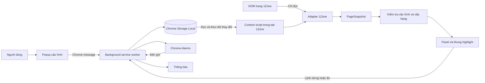
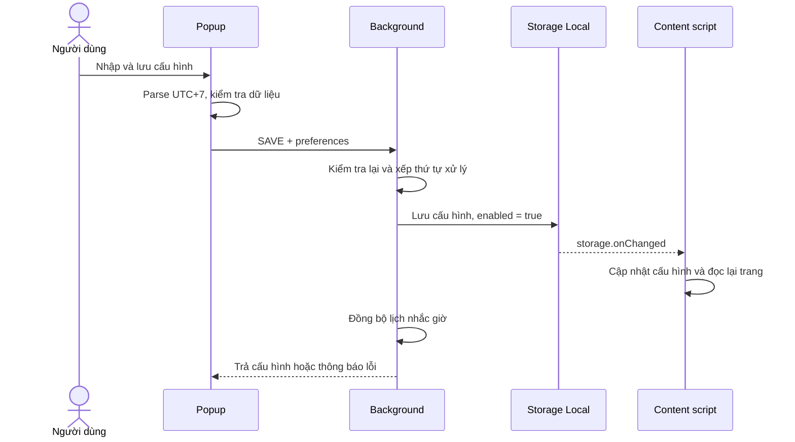

# Cơ chế hoạt động của Camp vé · 1Zone Assistant

> **Phạm vi:** giải thích bản MVP trong repository tại ngày 17/10/2026. Các tên hàm, cấu trúc dữ liệu và hành vi dưới đây được đối chiếu với source hiện tại.
>
> **Cách đọc:** phần 1–3 giải thích thiết kế tổng thể; phần 4–10 đi vào cơ chế; phần 11–14 mô tả cách xây dựng, kiểm thử và giới hạn. Mỗi phần có liên kết tới code liên quan.
>
> **Nguồn và rà soát chất lượng:** xem [đánh giá source, cơ chế chuẩn và giới hạn](REVIEW_VA_NGUON_THAM_KHAO.md).

## 1. Tool giải quyết phần nào của việc camp vé?

Tool hỗ trợ bạn chuẩn bị trước giờ bán và nhận biết các lựa chọn phù hợp trên trang 1Zone đang mở. Bạn cấu hình một concert, giờ mở bán, số vé, ngân sách và thứ tự hạng vé mong muốn. Tool dùng các thông tin đó để hiển thị countdown, nhắc giờ và đánh dấu lựa chọn trên giao diện.

Popup và demo mặc định **1 vé**, ngân sách để trống. Mặc định lấy từ `DEFAULT_QUANTITY` trong model; cấu hình đã được người dùng lưu vẫn được khôi phục đúng số lượng đó. Link và giờ bán phải nhập khi có thông báo chính thức. Ước tính toàn sự kiện có 100–200 vé không được dùng làm dữ liệu tồn kho trong code.

| Công việc | Bên thực hiện |
|---|---|
| Nhập concert, giờ bán, số vé và ưu tiên | Bạn |
| Lưu cấu hình, đếm ngược, nhắc giờ | Extension |
| Đọc trạng thái và các lựa chọn thể hiện trên trang | Extension |
| Lọc theo ưu tiên/ngân sách và vẽ khung gợi ý | Extension |
| Đăng nhập, vào phòng chờ, xử lý xác minh | Bạn trên website |
| Chọn vé, giữ chỗ, xác nhận đơn và thanh toán | Bạn trên website |

Đầu ra của tool là **thông tin hỗ trợ quyết định**. Khung xanh trên một hạng vé không tạo giỏ hàng, không giữ vé và không chứng minh còn đủ số lượng muốn mua.

## 2. Vì sao triển khai dưới dạng Chrome Extension?

Yêu cầu ban đầu cần một bản chạy trên máy cá nhân trước ngày thử, trong khi link concert chưa tồn tại. Extension cho phép đặt công cụ ngay cạnh giao diện 1Zone bạn đang dùng, tận dụng phiên trình duyệt hiện có mà không xây thêm hệ thống đăng nhập hay chạy browser trên server.

| Thành phần công nghệ | Vai trò trong project |
|---|---|
| Chrome Extension Manifest V3 | Đóng gói popup, background và content script thành tiện ích cài cục bộ |
| TypeScript | Định nghĩa dữ liệu và kiểm tra kiểu giữa các thành phần |
| React | Dựng form cấu hình và panel trạng thái |
| WXT + Vite | Nhận diện entrypoint, biên dịch, tạo manifest và bản build |
| Chrome Storage / Alarms / Notifications | Lưu cấu hình, đặt lịch nhắc và phát thông báo |
| Vitest / Playwright | Kiểm tra logic và luồng chạy trong trình duyệt |

Source được đặt trong **một project** để giảm cấu hình cần vận hành. Ranh giới giữa logic, đọc website và UI vẫn được tách để dễ sửa khi giao diện 1Zone thay đổi.

Code cấu hình: [wxt.config.ts](../wxt.config.ts), [package.json](../package.json).

## 3. Kiến trúc: các phần chạy ở đâu?



**Popup** là cửa sổ mở từ icon extension. Nó nhận dữ liệu, kiểm tra form và gửi lệnh. Đóng popup không xóa cấu hình đã lưu.

**Background service worker** xử lý lệnh thay đổi cấu hình, mở tab và đặt nhắc giờ. Nó không đọc DOM trang mua vé. Vì worker có thể bị dừng rồi chạy lại, code đọc trạng thái bền từ storage khi xử lý công việc.

**Content script** chạy trong tab thuộc `https://ticket.1zone.vn/*`. Nó đọc cấu hình, gọi adapter đọc trang, theo dõi thay đổi và gắn UI hỗ trợ vào trang.

**Core** chứa kiểu dữ liệu và các quy tắc kiểm tra/xếp hạng. Các hàm này không import React hoặc Chrome APIs nên có thể kiểm thử riêng bằng dữ liệu đầu vào.

| Nhóm source | Trách nhiệm | File nên đọc |
|---|---|---|
| `core/` | Dữ liệu, validation, thời gian, quy tắc gợi ý | [models.ts](../src/core/models.ts), [preferences.ts](../src/core/preferences.ts), [workflow.ts](../src/core/workflow.ts) |
| `platforms/` | Chuyển DOM website thành dữ liệu thống nhất | [onezone.ts](../src/platforms/onezone.ts) |
| `infrastructure/` | Kết nối logic với Chrome APIs | [storage.ts](../src/infrastructure/storage.ts), [messages.ts](../src/infrastructure/messages.ts), [reminders.ts](../src/infrastructure/reminders.ts) |
| `ui/` | Form, panel, observer và overlay | [Popup.tsx](../src/ui/Popup.tsx), [Panel.tsx](../src/ui/Panel.tsx), [mount-assistant.tsx](../src/ui/mount-assistant.tsx) |
| `entrypoints/` | Điểm khởi chạy từng ngữ cảnh | [background.ts](../src/entrypoints/background.ts), [onezone.content.tsx](../src/entrypoints/onezone.content.tsx) |

## 4. Dữ liệu được tổ chức thế nào?

### 4.1. Cấu hình bền: `TaskConfig`

Ví dụ minh họa sau **không phải link hoặc giờ bán thật**:

```json
{
  "schemaVersion": 1,
  "enabled": true,
  "panelVisible": true,
  "preferences": {
    "platform": "onezone",
    "eventUrl": "https://ticket.1zone.vn/events/vi-du?calendarId=A",
    "saleStartAt": "2026-10-18T05:00:00.000Z",
    "quantity": 1,
    "preferredZoneLabels": ["VIP", "Khu A"],
    "allowAlternatives": false
  }
}
```

| Trường | Ý nghĩa |
|---|---|
| `schemaVersion` | Phiên bản cấu trúc lưu trữ; hiện là `1` |
| `enabled` | Bật hay dừng theo dõi và nhắc giờ |
| `panelVisible` | Hiện/ẩn panel; độc lập với `enabled` |
| `preferences` | Cấu hình concert; chưa nhập thì là `null` |
| `maxTotalVnd` | Ngân sách tổng tùy chọn; không có trường này nghĩa là không đặt trần ngân sách |

`TaskConfig` được lưu tại khóa `ticket-assistant.config.v1` trong `chrome.storage.local`. Một khóa khác, `ticket-assistant.notified.v1`, giữ dấu của mốc nhắc gần nhất đã xử lý.

### 4.2. Dữ liệu tạm: `PageSnapshot`

Mỗi lần đọc trang, adapter trả về một bản mô tả:

```ts
{
  url,               // URL đang mở
  state,             // EVENT_PAGE, SELECTING, CHECKOUT, ...
  selectionMode,     // ZONE_ONLY, PICK_SEAT, ASSIGNED_SEAT, MIXED, UNKNOWN
  visibleOptions,    // Lựa chọn đọc được từ giao diện
  supported,         // Cờ được dùng để chặn/cho phép quy tắc gợi ý
  reason,            // Lý do hiển thị trên panel
  maxQuantity        // Giới hạn số vé đọc được, nếu có
}
```

Snapshot và tham chiếu đến các phần tử HTML nằm trong bộ nhớ của tab, không được lưu thành lịch sử tồn kho. Reload tab sẽ tạo snapshot mới từ trang hiện tại.

Mỗi `VisibleOption` chứa tên, giá, trạng thái khả dụng và ID như `option-0`. Trường `kind` phân biệt `ZONE` với `SEAT`; `zoneLabel` ghi nhãn khu nếu nhóm ghế có khai báo truy cập rõ ràng; `selected` ghi dấu đã chọn nếu DOM thể hiện bằng ARIA/input. ID là chỉ số tạm của lần đọc, **không phải mã vé/zone nội bộ của 1Zone**.

Code: [models.ts](../src/core/models.ts), [storage.ts](../src/infrastructure/storage.ts).

## 5. Điều gì xảy ra khi bấm “Lưu & bật theo dõi”?



Dữ liệu được kiểm tra cả ở popup và background. Popup giúp phản hồi lỗi sớm; background kiểm tra lại tại nơi nhận lệnh và ghi storage.

Các quy tắc chính:

- URL phải là HTTPS, đúng host `ticket.1zone.vn`, đường dẫn `/events/<tên-sự-kiện>` hoặc `/booking/<tên-sự-kiện>`, không chứa tài khoản/mật khẩu hay cổng tùy chỉnh. Link booking được chuẩn hóa thành event khi lưu.
- URL lưu lại giữ `calendarId` nếu có; bỏ fragment và các query khác như tracking.
- Số vé phải là số nguyên 1–100. Đây là giới hạn nhập của phần mềm; giới hạn concert vẫn được xét riêng khi đọc được.
- Ngân sách nếu nhập phải là số đồng nguyên dương.
- Tối đa 20 tên hạng vé, mỗi tên tối đa 100 ký tự; danh sách được trim và loại tên trùng hoàn toàn.
- Dữ liệu storage sai schema hoặc không hợp lệ được đưa về cấu hình mặc định, tắt theo dõi.

Background dùng một chuỗi Promise để xử lý các lệnh tuần tự, giảm nguy cơ hai thao tác cùng đọc cấu hình cũ rồi ghi đè nhau. Chuỗi Promise chỉ điều phối trong lần worker đang chạy; cấu hình bền vẫn nằm trong storage.

Popup cập nhật checkbox ẩn/hiện ngay khi click, sau đó chờ background lưu. Nếu lệnh lỗi, UI khôi phục trạng thái trước đó.

Code: [Popup.tsx](../src/ui/Popup.tsx), [preferences.ts](../src/core/preferences.ts), [background.ts](../src/entrypoints/background.ts).

## 6. Tool xác định đúng concert bằng cách nào?

Hàm `isSameEvent()` so sánh origin, đường dẫn và suất diễn trong cấu hình.

Giả sử URL đã lưu là `/events/vi-du?calendarId=A`:

| Trang đang mở trên cùng origin | Kết quả |
|---|---|
| `/events/vi-du?calendarId=A` | Khớp |
| `/events/vi-du/select?calendarId=A` | Khớp đường dẫn con và đúng suất |
| `/booking/vi-du?calendarId=A` | Khớp cùng event và suất ở bước booking |
| `/events/vi-du-khac?calendarId=A` | Không khớp |
| `/events/vi-du?calendarId=B` | Không khớp suất |
| `/events/vi-du` | Không khớp vì thiếu suất A đã lưu |

Nếu cấu hình không có `calendarId`, hàm không áp thêm điều kiện suất diễn. Đây là đối chiếu **dựa trên URL**, chưa xác minh danh tính concert bằng dữ liệu server.

Nút **Mở concert** tìm tab có URL phù hợp để đưa lên trước; nếu chưa có mới tạo tab. Nó không tự reload tab đang ở phòng chờ. Chưa có cơ chế khóa một tab duy nhất: các tab phù hợp cùng đọc một cấu hình chung.

Code: [preferences.ts](../src/core/preferences.ts), [background.ts](../src/entrypoints/background.ts).

## 7. Adapter đọc website và nhận diện trạng thái thế nào?

### 7.1. Nguồn dữ liệu là DOM

DOM là cây phần tử HTML mà trình duyệt dùng để dựng trang: tiêu đề, nút, nhãn, đoạn chữ, ô nhập liệu… Adapter đọc các phần tử và chữ đang được trình bày trên trang, không truy vấn API đặt vé hoặc đọc state nội bộ của ứng dụng 1Zone.

Hàm kiểm tra hiển thị loại các phần tử có `hidden`, `aria-hidden`, `inert`, CSS ẩn hoặc không có vùng bố cục; bỏ script, style và UI của chính extension. Một phần tử nằm ngoài vùng màn hình đang nhìn vẫn có thể được đọc nếu nó đang có trong bố cục trang.

Đây là **heuristic**, tức tập quy tắc suy luận theo dấu hiệu giao diện. Nó không phải mô hình AI nhận dạng ảnh. Khi cấu trúc hoặc câu chữ website đổi, có thể cần bổ sung quy tắc.

### 7.2. Trạng thái được tính lại sau mỗi lần quét

Code không ép website đi theo một chuỗi bước cố định. Mỗi lần quét, nó xét các dấu hiệu theo thứ tự ưu tiên:

| Thứ tự | Dấu hiệu chính | Kết quả |
|---|---|---|
| 1 | Tiêu đề xác minh hoặc iframe hiển thị có title chứa captcha/challenge | `CHALLENGE` |
| 2 | Tiêu đề thể hiện phòng chờ/hàng chờ | `WAITING_ROOM` |
| 3 | Tiêu đề thanh toán/xác nhận, kèm form hoặc nút liên quan | `CHECKOUT` |
| 4 | Tiêu đề/nút thể hiện chưa mở bán, kể cả khi nút chọn vé còn hiển thị | `NOT_READY`, không trả lựa chọn |
| 5 | Canvas/iframe hiển thị khi chọn ghế, hoặc không đọc được lựa chọn | `UNKNOWN`, lý do `UNSUPPORTED_VARIANT` |
| 6 | Có lựa chọn với nhãn, giá và điều khiển đọc được | `SELECTING` |
| 7 | URL event và dấu hiệu giới thiệu/mua vé/hết vé | `EVENT_PAGE` |
| 8 | Không đủ dấu hiệu | `UNKNOWN` |

Các tiêu đề chứa “hướng dẫn”, “quy định”, “điều khoản”, “giới thiệu” được bỏ khỏi nhóm tiêu đề dùng để nhận diện trạng thái. Việc đó giảm nhầm lẫn giữa mục “Hướng dẫn thanh toán” trên trang giới thiệu và bước thanh toán đang diễn ra.

Sau adapter, hàm `effectiveSnapshot()` áp thêm cấu hình:

1. Chưa có concert → `NOT_READY`.
2. Đã dừng → `STOPPED`.
3. Sai URL concert/suất → không cho gợi ý. Với phòng chờ, xác minh hoặc checkout, giữ trạng thái đã đọc và thêm cảnh báo chưa xác nhận thuộc event đã lưu; các trạng thái khác chuyển thành `UNKNOWN`.
4. Nếu qua các điều kiện trên → dùng kết quả adapter.

`UNSUPPORTED_VARIANT` hiện là chuỗi trong trường `reason`, không phải một giá trị riêng của `WorkflowState`. Cờ `supported` cũng không chứng nhận toàn bộ website đã tương thích: các trạng thái đã nhận diện như phòng chờ/xác minh/checkout vẫn đặt cờ này thành `false` để ngăn gợi ý.

### 7.3. Cách chọn chỗ là một thông tin riêng

| `selectionMode` | Dấu hiệu suy luận | Cách hiểu |
|---|---|---|
| `ASSIGNED_SEAT` | Chữ về tự động cấp số ghế | Website cấp ghế theo quy trình của sự kiện |
| `ZONE_ONLY` | Chữ “không chọn chỗ/ghế” | Mua theo khu vực |
| `PICK_SEAT` | Chữ về chọn ghế/chọn chỗ | Có hình thức chọn ghế cụ thể |
| `MIXED` | Cùng có dấu hiệu chọn ghế và khu không chọn ghế/tự cấp | Cần đối chiếu cách chọn của từng khu |
| `UNKNOWN` | Thiếu dấu hiệu | Chưa xác định được |

Thông tin này có thể đến từ mô tả sự kiện; nó không tự chứng minh giao diện chọn ghế hiện đã mở hoặc đọc được. Tool không suy ra ghế từ tọa độ canvas. Cấp ghế tự động có thể theo thứ tự, ngẫu nhiên hoặc quy tắc riêng; chưa thể khẳng định random nếu chưa có thông báo của đúng sự kiện.

Code: [onezone.ts](../src/platforms/onezone.ts), [workflow.ts](../src/core/workflow.ts).

## 8. Từ HTML đến danh sách gợi ý

### 8.1. Đọc một lựa chọn

Ví dụ HTML đơn giản mà adapter có thể hiểu:

```html
<article>
  <h3>VIP</h3>
  <p>1.200.000 ₫</p>
  <button>Chọn</button>
</article>
```

`readOptionElements()` tìm trong các phần tử có ngữ nghĩa như `button`, `article`, `label`, `li`, `section`, role `option`, `radio`, `group`.

Một ứng viên phải có nội dung gọn, đúng một giá trị giá phân biệt và nhãn đọc được. Với thẻ bao bên ngoài như `article`, code còn yêu cầu một tiêu đề hiển thị cùng điều khiển liên quan. Giá chấp nhận ký hiệu `₫`, `đ`, `VNĐ`, `VND` trước hoặc sau số; ví dụ `đ2.850.000` và `2.850.000 ₫`. Dấu phân cách hàng nghìn được bỏ để chuyển sang số đồng. Nút chỉ xem thông tin như “Xem tất cả”, “Xem chi tiết” không được dùng làm bằng chứng có thể chọn vé.

Các thẻ có nhiều giá khác nhau, nhãn quá dài hoặc nhãn giống thao tác thanh toán/xác nhận bị bỏ qua. Khi một điều khiển con có nhãn/giá hợp lệ, nó thay thế ứng viên container bao ngoài. Nhờ đó một nhóm ghế cùng giá có tiêu đề không bị gộp thành một zone. Sau khi loại trùng theo quan hệ bao lồng, giữ tối đa 100 lựa chọn theo thứ tự DOM rồi cấp ID tạm.

### 8.2. “Khả dụng” được suy ra từ giao diện

Nút bị `disabled`, `aria-disabled` hoặc chữ thể hiện hết vé làm lựa chọn thành `UNAVAILABLE`. Nếu có điều khiển phù hợp và không gặp dấu hiệu đó, lựa chọn được coi là `AVAILABLE` để xét gợi ý.

Đây là tình trạng UI. Adapter không biết chính xác server còn bao nhiêu vé, vé đã được người khác giữ hay hai ghế có liền nhau không.

Giới hạn giao dịch được đọc từ chữ dạng “tối đa 2 vé”. Nếu không tìm được, `maxQuantity` để trống; không tự mặc định mọi concert có cùng giới hạn.

### 8.3. Lọc và xếp hạng

Hàm `recommend()` thực hiện:

1. Chỉ tiếp tục nếu snapshot cho phép gợi ý, trạng thái là `SELECTING` và số vé không vượt giới hạn đã đọc được.
2. Bỏ lựa chọn không phải `AVAILABLE` hoặc đã được đánh dấu chọn. Nếu là một ghế cụ thể, chỉ xét khi yêu cầu đúng 1 vé; chưa hỗ trợ gợi ý nhóm ghế.
3. Chuẩn hóa tên: bỏ dấu, chuyển chữ thường và gộp khoảng trắng; sau đó so sánh bằng nhau, không tìm gần đúng. Với ghế có `zoneLabel` từ nhóm có nhãn rõ ràng, tên khu đó cũng được xét với danh sách ưu tiên.
4. Nếu có danh sách ưu tiên và tắt phương án thay thế, bỏ tên nằm ngoài danh sách.
5. Tính `tổng tạm tính = giá hiển thị × số vé`. Có trần ngân sách thì loại lựa chọn vượt trần hoặc thiếu giá rõ ràng.
6. Sắp theo vị trí trong danh sách ưu tiên; cùng mức ưu tiên thì sắp tổng tạm tính tăng dần.

Ví dụ chọn **2 vé**, ưu tiên `VIP → Khu A`, ngân sách **1.700.000 đồng**:

| Hạng | Giá/vé | Tổng 2 vé | Kết quả |
|---|---:|---:|---|
| VIP | 1.200.000 | 2.400.000 | Loại vì vượt ngân sách |
| Khu A | 800.000 | 1.600.000 | Gợi ý |
| Khu B | 500.000 | 1.000.000 | Loại nếu ngoài ưu tiên và không cho thay thế |

Nếu bỏ ngân sách, VIP được xếp trước Khu A theo ưu tiên, dù đắt hơn. Tổng tiền này chưa cộng phí. Tên `VIP` không tự khớp `VVIP` hay `VIP 2`; ưu tiên `Khu A` cũng không tự chuyển thành ghế `A1`, `A2`.

Panel và overlay lấy tối đa **4 gợi ý đầu tiên** từ cùng kết quả xếp hạng. Với khu vực/hạng, giá tạm tính nhân số lượng; một ghế cụ thể chỉ là phương án cho 1 vé. Chưa tối ưu tổ hợp nhiều hạng hoặc nhóm ghế liền nhau.

Code: [onezone.ts](../src/platforms/onezone.ts), [workflow.ts](../src/core/workflow.ts).

## 9. Theo dõi thay đổi và vẽ highlight

### 9.1. Khi nào trang được đọc lại?

Một lần quét ban đầu diễn ra khi content script gắn UI. Sau đó, tool phản ứng với thay đổi cấu hình, DOM, URL SPA, kích thước cửa sổ, trạng thái hiển thị tab hoặc nút **Nhận diện lại**.

Một lần `inspectOnezonePage()` trả cả snapshot và liên kết tới chính phần tử đã đọc. Controller dùng các liên kết đó để highlight, không chạy bộ đọc option lần hai; panel cũng nhận sẵn danh sách gợi ý. Visibility và text được cache trong phạm vi lần inspect, sau đó bỏ để lần tiếp theo đọc DOM mới.

**SPA** là website có thể đổi URL và nội dung mà không tải lại toàn bộ trang. Content script dùng sự kiện đổi URL của WXT, cùng các listener `popstate`/`hashchange`, để yêu cầu nhận diện lại.

`MutationObserver` theo dõi thêm/xóa phần tử, đổi chữ và một số thuộc tính như `class`, `style`, `disabled`, `aria-label`. Các thay đổi liên tiếp được gom bằng bộ hẹn giờ: lịch quét tự động đặt theo khoảng cách mục tiêu khoảng **600 ms**, thời gian chờ tối thiểu **100 ms**. Vì vậy, hàng loạt mutation không tạo từng ấy lần quét. Nút quét thủ công và cập nhật cấu hình có thể gọi quét trực tiếp.

Các thuộc tính `aria-selected`, `aria-checked`, `checked`, `value` cũng được quan sát để cập nhật khi người dùng thay đổi lựa chọn.

Khi dừng hoặc ẩn panel, code bỏ qua đọc DOM của adapter và không lên lịch quét tự động mới. Nhắc giờ vẫn tiếp tục nếu chỉ ẩn panel. Bộ đếm giây trên panel là timer UI riêng, không gửi request kiểm tra vé.

### 9.2. Khung xanh là lớp vẽ riêng

Tool tạo một phần tử chứa UI riêng rồi gắn **Shadow DOM** để tách phần lớn CSS của extension khỏi CSS website.

Với mỗi lựa chọn được gợi ý, code lấy vị trí/kích thước qua `getBoundingClientRect()`, sau đó vẽ một hình chữ nhật `position: fixed` tương ứng. Lớp khung dùng `pointer-events: none`, nên click tại vùng khung đi tới phần tử website bên dưới. Panel có vùng tương tác riêng; có thể thu gọn hoặc ẩn nếu vướng.

Khi cuộn trang, `requestAnimationFrame()` gom việc cập nhật vị trí khung theo nhịp vẽ. Code không thay đổi trạng thái selected, giá trị ô số lượng hoặc thực hiện click lên điều khiển mua vé.

Observer bỏ qua UI của extension; thay đổi bên trong Shadow DOM cũng không trở thành nội dung website mà adapter đọc. Khi content script bị hủy, code ngắt observer, xóa listener/timer liên quan và unmount UI.

Code: [mount-assistant.tsx](../src/ui/mount-assistant.tsx), [onezone.content.tsx](../src/entrypoints/onezone.content.tsx), [Panel.tsx](../src/ui/Panel.tsx).

## 10. Countdown và nhắc giờ hoạt động độc lập

### 10.1. Chuẩn hóa giờ nhập

Ô `datetime-local` không chứa múi giờ. Hàm `fromVietnamLocal()` diễn giải dữ liệu đó theo UTC+7 rồi lưu ISO UTC.

```text
Nhập:  18/10/2026 12:00 theo giờ Việt Nam
Lưu:   2026-10-18T05:00:00.000Z
```

Panel hiển thị lại bằng múi giờ `Asia/Ho_Chi_Minh`. Countdown mỗi giây tính chênh lệch giữa mốc đã lưu và `Date.now()`; không đếm trừ bằng một biến rồi tin rằng mỗi tick luôn đúng một giây.

### 10.2. Alarm do background điều phối

`reconcileReminder()` đọc cấu hình rồi quyết định:

| Điều kiện | Hành động |
|---|---|
| Chưa cấu hình hoặc đã dừng | Xóa alarm |
| Giờ bán còn ở tương lai | Tạo/cập nhật alarm tên `ticket-assistant.sale` |
| Đã tới giờ, trễ dưới 15 phút, chưa có dấu nhắc tương ứng | Xét phát thông báo |
| Trễ từ 15 phút hoặc mốc gần nhất đã xử lý | Bỏ qua nhắc |

Một tên alarm dùng chung giúp việc lưu lại không sinh nhiều lịch song song. Hàm đồng bộ được gọi khi xử lý lệnh, storage đổi, alarm kích hoạt, extension cài/khởi động hoặc worker được chạy lại.

### 10.3. Chống nhắc lặp và khôi phục

Dấu nhắc được tạo bằng `eventUrl + "|" + saleStartAt`. Code lưu dấu **trước** khi gọi Notifications API để lần worker sau không phát lại cùng mốc chỉ vì mất biến trong bộ nhớ. Đổi số vé hoặc ngân sách không đổi dấu nhắc.

Cách làm ưu tiên tránh phát lặp; nó không bảo đảm người dùng đã nhìn thấy thông báo. Nếu lời gọi Notifications API lỗi, code thử hiện badge `GIỜ`. Dấu lưu hiện chỉ giữ mốc gần nhất, không phải lịch sử đầy đủ của nhiều concert.

Chrome phải còn chạy; sleep và lịch xử lý của browser/OS có thể làm nhắc trễ. Tool dùng đồng hồ máy, chưa đồng bộ thời gian server. **Đến giờ đã nhập không đồng nghĩa 1Zone đã mở bán**, và nhận diện thấy vé cũng không tự làm tool phát thông báo tồn kho: bản hiện tại chỉ có nhắc theo giờ cấu hình.

Code: [preferences.ts](../src/core/preferences.ts), [workflow.ts](../src/core/workflow.ts), [reminders.ts](../src/infrastructure/reminders.ts).

## 11. Dữ liệu nào còn sau khi đóng tab hoặc khởi động lại?

| Dữ liệu/trạng thái | Nơi giữ | Cơ chế khôi phục |
|---|---|---|
| Concert, số vé, ngân sách, ưu tiên | Storage Local | Popup/content script đọc lại |
| Đang theo dõi hay đã dừng | Storage Local | Áp lại từ `enabled` |
| Ẩn/hiện panel | Storage Local | Áp lại từ `panelVisible` |
| Dấu nhắc gần nhất | Storage Local | Kiểm tra trước khi phát thông báo |
| Alarm | Chrome Alarms | Background dựng lại từ cấu hình nếu cần |
| Snapshot, tham chiếu HTML, vị trí khung | Bộ nhớ tab | Đọc và vẽ lại từ DOM |
| Trạng thái thu gọn panel | React state trong tab | Trở về mặc định khi UI được tạo mới |

Một cấu hình được chia sẻ giữa các tab phù hợp. Dừng từ panel một tab sẽ thay đổi cấu hình chung, hủy nhắc giờ và được các tab khác nhận qua `storage.onChanged`.

Content script đăng ký theo dõi storage trước khi chờ đọc cấu hình ban đầu, để hạn chế bỏ lỡ một lần lưu xảy ra đúng lúc khởi tạo.

## 12. Tôi đã xây dựng và kiểm tra tool theo cách nào?

| Bước | Công việc | Mục đích |
|---|---|---|
| 1 | Đọc brief, kiểm tra repo và trang 1Zone công khai | Chốt phạm vi; nhận ra event mục tiêu chưa có |
| 2 | Tạo project WXT và các entrypoint | Có bản MV3 biên dịch/cài được |
| 3 | Xây model, validation, quy tắc thời gian và gợi ý | Kiểm thử logic độc lập với website |
| 4 | Nối popup, messages và storage qua background | Lưu/khôi phục cấu hình giữa các ngữ cảnh |
| 5 | Viết adapter đọc DOM và UI panel/overlay | Biến giao diện nhìn thấy thành gợi ý |
| 6 | Thêm alarm và dấu chống nhắc lặp | Duy trì nhắc giờ khi popup đóng/worker chạy lại |
| 7 | Tạo fixtures và demo nội bộ | Diễn tập khi chưa có concert thật |
| 8 | Chạy unit tests, E2E, kiểm tra trang công khai, build/zip | Xác minh hành vi và tạo bản bàn giao |

**Fixture** là HTML mô phỏng một tình huống, chẳng hạn khu vực hết vé, phòng chờ hoặc sơ đồ canvas. Demo nạp fixtures vào iframe do extension tạo và dùng lại adapter/panel. Nó có cấu hình tạm riêng, không ghi đè concert bạn đã lưu.

Demo đọc được iframe của chính nó vì code truyền trực tiếp document đó vào bộ gắn UI; điều này không có nghĩa extension đã hỗ trợ đọc mọi iframe trên website 1Zone.

Hai lớp kiểm thử chính:

- **Unit tests:** kiểm tra đầu vào và quyết định cụ thể như phân biệt VIP/VVIP, tổng ngân sách, UTC+7, DOM ẩn, giá mơ hồ, các trạng thái chặn và chống nhắc lặp. Test DOM dùng jsdom, mô phỏng phần layout cần thiết.
- **E2E bằng Playwright:** load extension production vào Chromium với profile test riêng. Request trang fixture được chặn để trả HTML local; popup, background, storage và content script vẫn chạy thật. Các ca gồm lưu/reload, DOM/SPA đổi, dừng/ẩn/hiện, dùng lại tab và khôi phục alarm sau đóng/mở browser.

Kết quả kiểm thử được cập nhật ở [VALIDATION.md](./VALIDATION.md), gồm môi trường, kiểm tra trang công khai và phần chưa xác minh. Xem thêm [khảo sát các case 1Zone](./KHAO_SAT_1ZONE.md) để hiểu sự khác biệt giữa ảnh sơ đồ, hạng vé và điều khiển có thể chọn. Các kết quả được ghi theo lần chạy, không xác nhận trước mọi thay đổi source sau này.

## 13. Phạm vi quyền và giới hạn kỹ thuật

Manifest production khai báo `storage`, `alarms`, `notifications` cùng host `https://ticket.1zone.vn/*`. Source không yêu cầu quyền cookies; phiên mua vé vẫn do website và trình duyệt của bạn quản lý. Project không có backend, telemetry hoặc cơ chế gửi dữ liệu DOM lên server.

Những giới hạn cần hiểu khi đánh giá kết quả:

| Giới hạn hiện tại | Hệ quả |
|---|---|
| Chưa có URL fan meeting mục tiêu tại lúc bàn giao | Chưa xác minh DOM/luồng chọn vé của sự kiện đó |
| Adapter dùng quy tắc ngữ nghĩa tổng quát | Website có thể hiển thị vé nhưng tool không nhận được |
| Canvas/iframe hoặc nhãn ghế thiếu dữ liệu | Có thể trả `UNKNOWN` và yêu cầu thao tác trực tiếp |
| Không có API tồn kho hay lịch sử theo dõi tồn kho | Không xác nhận đủ vé, không tự thông báo khi có vé trở lại |
| Không chọn vé/tạo đơn | Tốc độ giữ chỗ vẫn phụ thuộc thao tác và quy trình website |
| Đối chiếu danh tính bằng URL | Route mới hoặc mất `calendarId` có thể bị coi là chưa khớp |
| Chỉ một cấu hình chung | Chưa có quản lý nhiều task hoặc phối hợp nhiều tab |

Thiết kế có interface `PlatformAdapter` để thêm bộ đọc website khác. Tuy nhiên, content script và validation URL hiện vẫn gắn với 1Zone; `EventPreferences.platform` cũng đang giới hạn ở `'onezone'`. Muốn thêm nền tảng cần mở rộng những điểm đó cùng manifest và tests, không chỉ tạo thêm một class. Ticketbox/CTicket hiện trả `unsupported`.

Code: [wxt.config.ts](../wxt.config.ts), [models.ts](../src/core/models.ts), [unsupported.ts](../src/platforms/unsupported.ts).

## 14. Nên đọc source theo thứ tự nào?

1. [models.ts](../src/core/models.ts): hiểu dữ liệu cấu hình, lựa chọn và snapshot.
2. [preferences.ts](../src/core/preferences.ts): theo dõi validation URL, đúng event và chuyển đổi UTC+7.
3. [workflow.ts](../src/core/workflow.ts): xem điều kiện gợi ý, thứ tự ưu tiên và điều kiện nhắc giờ.
4. [onezone.ts](../src/platforms/onezone.ts): xem dữ liệu đó được rút ra từ HTML bằng cách nào.
   Bộ đọc chi tiết được tách ở [onezone-dom.ts](../src/platforms/onezone-dom.ts), [onezone-options.ts](../src/platforms/onezone-options.ts) và [onezone-selection.ts](../src/platforms/onezone-selection.ts).
5. [mount-assistant.tsx](../src/ui/mount-assistant.tsx): nối adapter → kiểm tra cấu hình → gợi ý → vẽ UI.
6. [Popup.tsx](../src/ui/Popup.tsx) và [background.ts](../src/entrypoints/background.ts): theo một lần lưu từ form tới storage.
7. [reminders.ts](../src/infrastructure/reminders.ts): hiểu lịch nhắc và khôi phục sau worker restart.
8. [tests/unit](../tests/unit/) và [tests/e2e/extension.spec.ts](../tests/e2e/extension.spec.ts): đối chiếu từng hành vi với tình huống kiểm tra.

Để tự quan sát cơ chế, mở **Bản diễn tập**, đổi từ Chọn khu vực sang Phòng chờ rồi Canvas; đối chiếu `state`, `supported`, `reason` trong adapter với nội dung panel và việc khung xanh xuất hiện hay biến mất.
